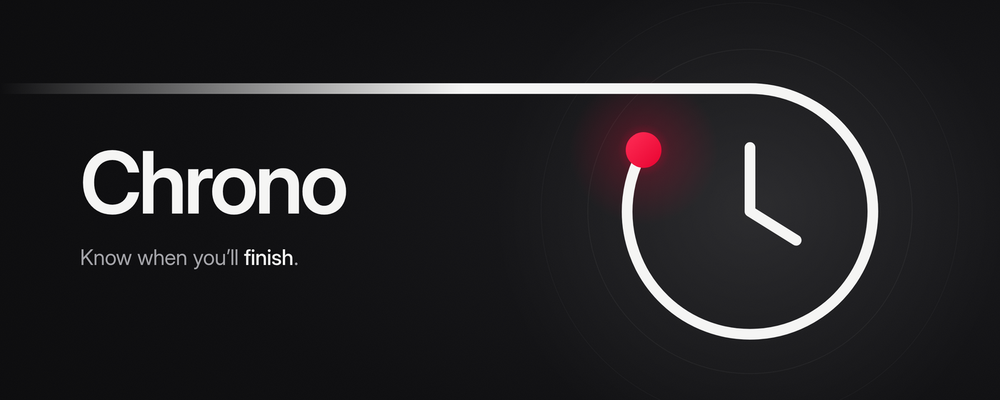
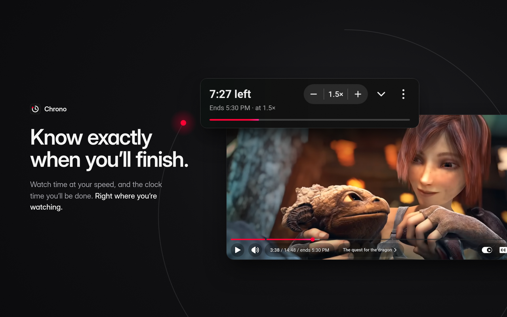
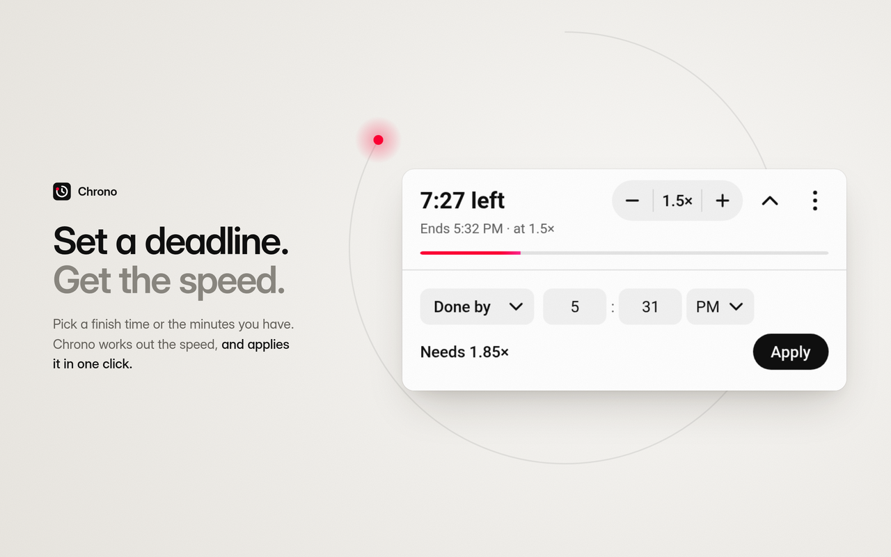
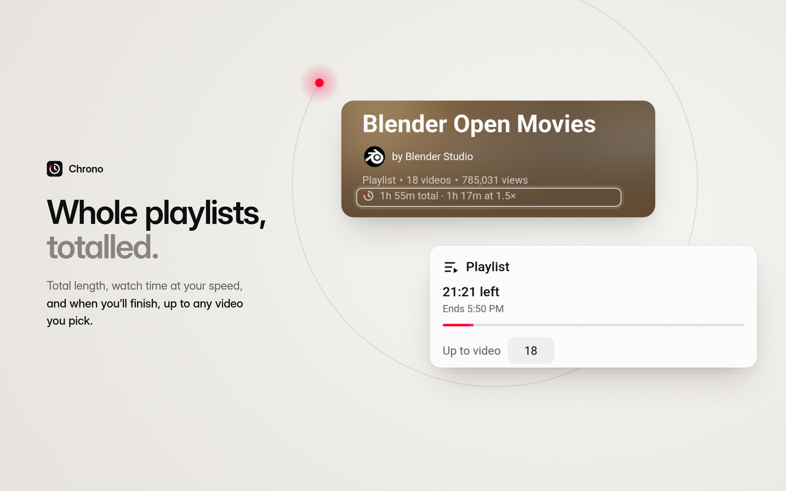
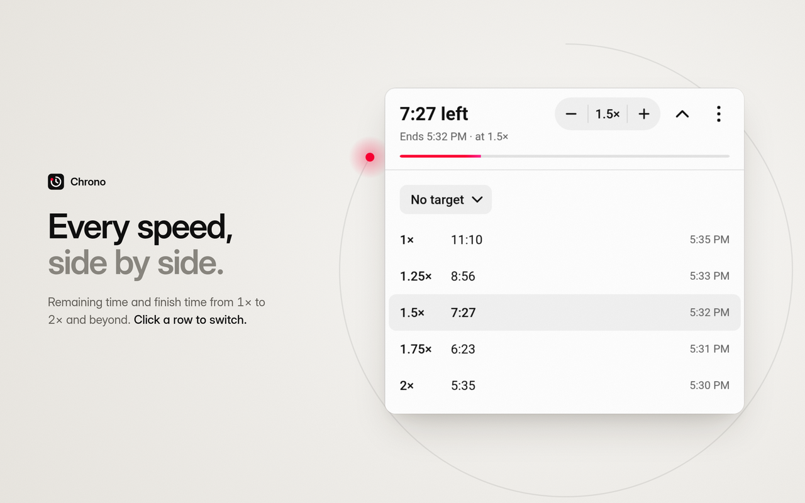
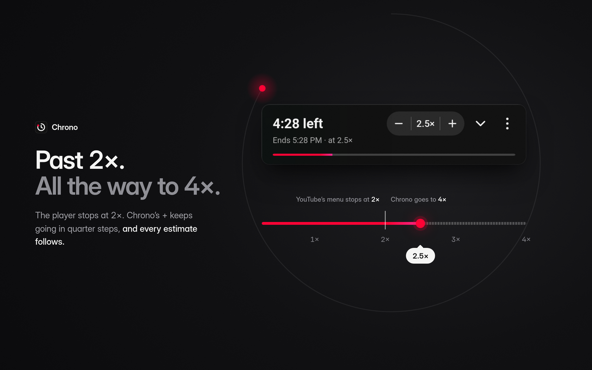

<div align="center">



<br>

**Finish times and watch time for YouTube, at your speed.**

How long a video, chapter or playlist really takes at the speed you watch, and the moment you'll be done, shown right where you're already looking.

<br>

[](https://chromewebstore.google.com/detail/albpnoibahehboglkghilhljilchnfbo)
[](https://addons.mozilla.org/firefox/addon/chrono-cptdawn/)
[](LICENSE)
[](docs/adr/0002-no-telemetry.md)

[**Website**](https://chrono.cptdawn.dev/) · [**Chrome**](https://chromewebstore.google.com/detail/albpnoibahehboglkghilhljilchnfbo) · [**Firefox**](https://addons.mozilla.org/firefox/addon/chrono-cptdawn/) · [**Help**](https://chrono.cptdawn.dev/help)

</div>

<br>

<p align="center">
  
</p>

## Why

YouTube tells you a video is 48 minutes long. At 1.5× it isn't, and the number you actually want is the time on the clock when it ends. Chrono does that arithmetic for you, quietly, inside YouTube's own interface, and keeps it current as you seek, change speed or move through a playlist.

## What you get

- **The Panel.** A compact block at the top of YouTube's sidebar, drawn to look like part of YouTube. At a glance: what's **left** at your speed ("12:30 left"), when it **ends** ("Ends 3:45 PM · at 1.5×"), and speed − / +. Open it for more:
  - the **speed table**, with the time left and finish time at every common speed;
  - the **Chapter** and **Playlist** scopes, for when the video isn't the whole story;
  - **targets**: give it a time to finish by, or the minutes you have, and it tells you the speed you need.
- **The Player badge.** An optional "/ ends 3:45 PM" beside the player's own clock, which stays visible in fullscreen.
- **The Playlist summary.** One line on any playlist page: "4h 12m total · 2h 48m at 1.5× · 3 unavailable".
- **Past 2×.** Chrono's speed and YouTube's stay in step up to YouTube's 2×. Beyond that, Chrono's + carries on to 4× and remembers your speed from video to video.
- **Good manners.** It follows YouTube's light or dark theme, holds still during ad breaks, and tells screen readers what matters without narrating every tick.

<table>
  <tr>
    <td width="50%"></td>
    <td width="50%"></td>
  </tr>
  <tr>
    <td width="50%"></td>
    <td width="50%"></td>
  </tr>
</table>

## Install

| Browser | Get it | Requires |
| --- | --- | --- |
| Chrome, Edge, Brave, Vivaldi, Arc | [Chrome Web Store](https://chromewebstore.google.com/detail/albpnoibahehboglkghilhljilchnfbo) | Chrome 121 or later |
| Firefox (desktop) | [Firefox Add-ons](https://addons.mozilla.org/firefox/addon/chrono-cptdawn/) | Firefox 142 or later |

Chrome is the tested Chromium browser. The others install from the Chrome Web Store and should work, though they aren't tested.

## Privacy

Chrono collects nothing. No analytics, no crash reports, no usage tracking, no account ([ADR-0002](docs/adr/0002-no-telemetry.md)). Its only permission is storage for your settings, and it runs only on youtube.com.

"Get help" and "Report it" open a page on chrono.cptdawn.dev, and only when you click them. They fill in your Chrono version, browser and OS and, for a report, which parts of YouTube's page Chrono recognised. They never carry a video ID, title or address. The full policy is at [chrono.cptdawn.dev/privacy](https://chrono.cptdawn.dev/privacy).

## Development

Requires [Bun](https://bun.sh) and Node.js 22.18 or later (WXT and Vitest run on Node).

```sh
bun install --frozen-lockfile
bun run dev            # Chrome, with live reload
bun run dev:firefox    # Firefox
bun run typecheck
bun run test
```

To try a build by hand, load `.output/chrome-mv3` as an unpacked extension in `chrome://extensions`, or `.output/firefox-mv3/manifest.json` as a temporary add-on in `about:debugging`.

<details>
<summary><b>Testing against saved YouTube pages</b></summary>
<br>

The tests run Chrono on saved YouTube pages in `tests/pages/`. When YouTube changes its page, capture the live page from a real browser with Chrono off and ad blockers off: save it with SingleFile, or run `copy(document.documentElement.outerHTML)` in DevTools and paste it into a file. Then trim it:

```sh
bun run trim-page -- <saved.html> tests/pages/<name>.html
```

The trimmer:

- rewrites each link nested inside another link as a `<span>`, so the page keeps its structure when parsed;
- removes scripts, styles, inline `data:` images, SingleFile's markup and anything personal, such as the signed-in masthead and comments;
- records where and when SingleFile saved the page in a leading comment;
- writes one element per line, so diffs stay readable.

It reports how many nested links it rewrote and the page's size before and after.

</details>

<details>
<summary><b>Packaging a release</b></summary>
<br>

```sh
bun run package
```

This writes three files to `.output/`, then runs `web-ext lint` on the Firefox build:

- `chrono-<version>-chrome.zip` for the Chrome Web Store
- `chrono-<version>-firefox.zip` for Firefox Add-ons
- `chrono-<version>-sources.zip`, the source package Firefox Add-ons asks for

To rebuild the Firefox extension from the sources package (for Firefox Add-ons source review), run `bun install --frozen-lockfile && bun run build:firefox`. The result is in `.output/firefox-mv3`.

Before a release, work through the [release checklist](docs/release/checklist.md). The store listing text is in [store-listing.md](docs/release/store-listing.md).

</details>

### Where to look

- [GLOSSARY.md](GLOSSARY.md) defines the terms used in the code and docs.
- [docs/adr/](docs/adr/) holds the decisions and their reasons.
- [Issues](https://github.com/CPT-Dawn/Chrono/issues) are where bugs and ideas go.

## License

[MIT](LICENSE) © CPT Dawn
